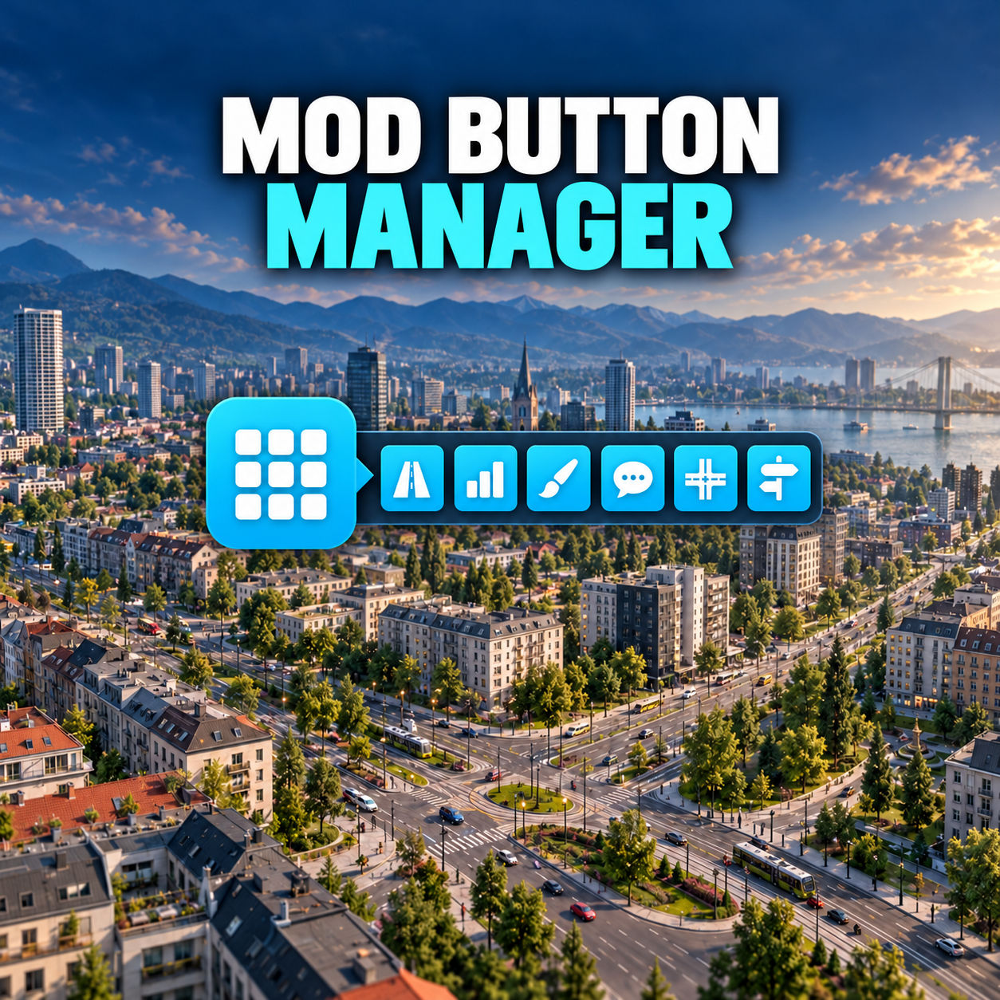

**Mod Button Manager**

  

Keep your interface organized by collecting supported mod buttons in a compact, customizable menu.

Choose one button for all your mods or separate buttons for the left and right sides of the screen. Decide which buttons belong in the manager and keep the others in their original positions.

**Features**

- One shared launcher or separate left and right launchers.
- Independent opening directions: below, left or right.
- Arrange buttons in one or two rows.
- Menus stay open when clicking elsewhere.
- Move the launcher buttons freely and lock their positions in the options.
- Saved launcher positions, opening states and button selection.
- Page controls for larger button collections.
- English, German, French, Italian and Spanish localization.

**Button selection**

Enable **Hide buttons (selection mode)** in the mod options, then right-click buttons inside the manager to exclude them.

Excluded buttons immediately return to their original positions in the game interface. While selecting, their previews remain visible in the manager at **40% opacity**. Right-click a preview to include the button again.

Disable selection mode when finished. The previews disappear, leaving only your selected buttons in the manager.

**Controls**

- **Left-click** a launcher to open or close its menu.
- **Right-click** a launcher to open the settings.
- **Drag** a launcher to move it when its position is unlocked.

**Compatibility**

Supports compatible mod launcher buttons registered through the game’s standard top-left and top-right mod UI hooks. Buttons in other toolbars or the Universal Mod Menu are not collected.